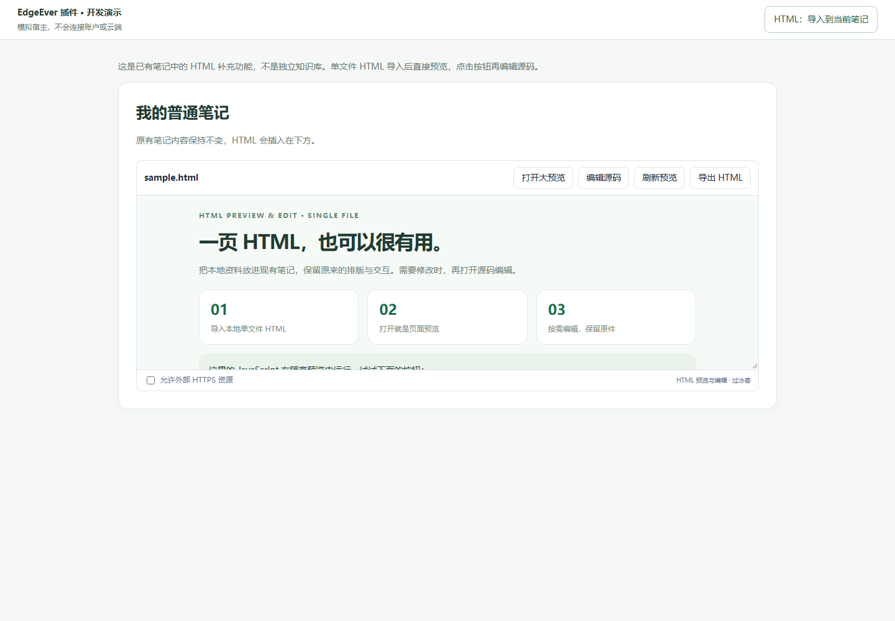
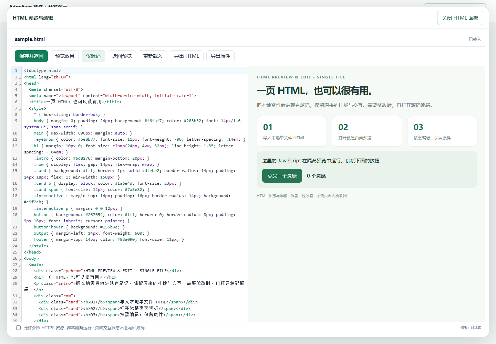

# edgeever-html-knowledge

### HTML 预览与编辑 · EdgeEver 插件

**作者：过冰客 · 版本：0.1.0 · EdgeEver 插件 API v2**

给 EdgeEver 现有笔记补充 HTML 能力，不新建知识库、不添加分类或搜索系统。

> **先阅读，需要时再编辑。** 将本地单文件 HTML 导入已有笔记，保留原页面的排版与交互；点击「编辑源码」才进入编辑器。

## 功能

- 导入本地 `.html` / `.htm` 单文件，默认在笔记内显示页面预览。
- 内嵌 CSS、JavaScript、按钮、折叠、Canvas 等在隔离 iframe 中运行。
- 点击 **编辑源码** 才打开源码编辑器：语法高亮、行号、查找替换、撤销重做、可选分屏。
- 手动预览草稿，保存并返回阅读；保存与页面刷新分开。
- 单独保留导入原件；支持导出编辑后的 HTML 和原件。
- 保存使用附件内容哈希进行并发检查。失败保留源码，提供本地恢复草稿。

## 界面预览

以下为真实插件 Bundle 在本地模拟宿主中的截图，不是 EdgeEver 实机截图。

**默认预览**



**按需源码编辑与分屏**



## 通过 GitHub Release 安装

[v0.1.0 正式版](https://github.com/guobingke/edgeever-html-knowledge/releases/tag/v0.1.0) 已发布，附有宿主要求的独立 `manifest.json` 和 `main.js`。

在 EdgeEver 插件市场的 GitHub 安装入口输入仓库地址：

```text
https://github.com/guobingke/edgeever-html-knowledge
```

若遇到 `GitHub release request failed with HTTP 403` 或 HTTP 429，可能是 GitHub API 限流；发布 Release 不会重置调用方额度。请改用下面的直接 Manifest 地址。

## 通过 Manifest 安装（遇到限流时优先）

在 EdgeEver 插件市场的 Manifest 安装入口输入：

```text
https://raw.githubusercontent.com/guobingke/edgeever-html-knowledge/main/dist/manifest.json
```

确认作者 **过冰客** 和能力声明后启用插件。此地址使用仓库中已构建的 `dist/main.js`，无需先在本机安装 Node.js。

此方式直接下载已构建文件，不经过 GitHub Release 元数据查询。真实宿主的安装与同步仍待实机验收。

## 本地试用 / 安装

推荐 Node.js 24+（本项目验证环境为 Node.js 25.2.1）。克隆仓库后执行：

```powershell
git clone https://github.com/guobingke/edgeever-html-knowledge.git
cd edgeever-html-knowledge
npm ci
npm run build
npm run dev
```

依赖已经安装时，可直接执行 `npm run dev`。服务器仅监听本机 `127.0.0.1:4173`。

1. 在 EdgeEver 插件市场的安装入口输入 Manifest 地址：
   `http://127.0.0.1:4173/dist/manifest.json`。
2. 确认插件信息与能力声明，启用 **HTML 预览与编辑**。
3. 打开一篇**已同步的普通笔记并进入编辑状态**。
4. 在插件命令/快捷菜单中运行 **HTML：导入到当前笔记**。
5. 选择或拖入一个本地 HTML；导入完成后默认显示预览。
6. 关闭面板，按 EdgeEver 的正常流程保存笔记，以持久化新增的嵌入块。
7. 以后在该块上点击 **编辑源码**，修改后选择 **保存并返回**。

调试安装和更新时保持本地服务器运行。若 Web 端受浏览器本地网络访问策略限制，需在浏览器中允许该站点访问本机，或将 `dist/` 放到宿主同源静态路径/可信 HTTPS 静态站点。不要把 `src/` 入口直接交给宿主。

本项目不会自动操作你的 EdgeEver 或真实笔记。本地包不是浏览器扩展；不要在 Chrome 扩展管理器里安装。

### 不安装即可体验

运行本地服务器后，打开 [开发演示](http://127.0.0.1:4173/demo/)。导入 `demo/sample.html` 可测试按钮交互。

这是加载真实插件 Bundle 的**模拟宿主**，不是 EdgeEver，不连接任何账户。演示数据保存在该本地站点的浏览器存储中。真实宿主的安装、同步和桌面桥仍需应用内验收，详见 [开发演示说明](demo/README.md)。

## 使用细节

- 一次导入一个文件，每个文件最大 **10 MiB**。第一版不处理 HTML + 图片/CSS/JS 文件夹或 ZIP。
- 原件按原始字节单独作为附件保留；工作件使用 UTF-8，真实 meta 编码声明会相应调整。支持读取 UTF-8、带 BOM 的 UTF-16、声明了 GBK/GB2312 的旧中文页面。
- 导入和保存均只操作笔记附件，不改动电脑上选择的源文件。
- 源码编辑期间不会每次按键刷新页面；点击 **预览效果** 或切换分屏才更新预览，避免反复重置交互状态。
- 保存的是 HTML 源码，不是页面运行后的 DOM、表单填写值或小游戏进度。
- 修改后关闭会提醒；宿主强制换面板时，也会尝试保留本地草稿。草稿不跨设备同步，存储失败会提示，重要修改请先导出。
- 过期草稿不会自动获得新版附件的哈希，也不会自动覆盖他人修改。请先导出草稿，再明确放弃修改并重新载入。
- 恢复草稿是本地最佳努力保护，尚无跨窗口独占机制；避免在多个窗口同时编辑同一 HTML，重要修改请分别导出。附件保存本身仍会检查哈希冲突。

## 兼容与安全边界

- 当前公开 API 未提供附件点击拦截器，因此入口是 **导入命令 + 笔记内 HTML 嵌入块**，不接管所有现有 `.html` 附件。
- 需支持资源内容哈希及 `resources.update(expectedContentHash)` 的当前宿主。无哈希、`local_resource_` 待同步资源会阻止插入，避免同步后生成失效引用。导入失败时，已上传的附件仍保留，错误会列出资源 ID 供恢复。
- Web 宿主离线或附件尚未同步时可能拒绝更新；此时源码仍保留，可导出后等待同步。**不承诺离线附件保存。**
- iframe 仅设置 `sandbox="allow-scripts"`，不开放同源、弹窗、表单提交、顶层导航或嵌套页面权限；插件不接受页面消息作为宿主指令。
- 默认 CSP 限制常见外部资源和请求。仅对可信文件勾选 **允许外部 HTTPS 资源**；启用后页面能向外部 HTTPS 地址加载资源和发送数据，且需要相应服务支持 CORS。
- CSP 不是断网防火墙：iframe 自身导航等行为不等于绝对零联网。页面执行不是 OS 级隔离，死循环或高资源消耗脚本仍可能卡住页面。不要运行不可信的恶意 HTML。
- `localStorage`、IndexedDB、父窗口 DOM、宿主凭据、文件系统路径、下载/弹窗、部分模块和依赖同源的网页应用不保证兼容。文件自带 CSP、宿主 CSP 也可能进一步限制脚本。
- 支持 Web 和桌面端；当前原生 Android/iOS 不运行此类插件。卸载插件不会自动删除笔记附件；禁用插件后嵌入块可能退化为占位标题，原件仍可通过附件访问。
- 宿主普通阅读视图可挂载嵌入预览；Markdown 源码模式会显示嵌入块围栏。公开分享页没有插件运行环境，不支持此插件的交互预览；需要独立使用时请导出 HTML。

## 开发与验证

当前本地验证：**143 项单元/集成测试 + 4 项浏览器 E2E 通过**；语句覆盖率 **98.05%**、分支覆盖率 **91.55%**。这些结果来自模拟宿主，不代替真实 EdgeEver 的实机测试。

```powershell
npm test
npm run coverage
npm run build
npm run test:e2e
npm audit
```

E2E 优先使用本机现有 Playwright Chromium headless shell；若没有，先执行 `npx playwright install chromium`。

- `src/`：插件源代码；`tests/`：单元、集成与浏览器测试。
- `dist/manifest.json` + `dist/main.js`：可分发产物；Bundle 内含编辑器与样式，无 CDN 依赖。
- `docs/verification.md`：验证记录与真实宿主验收步骤。
- `docs/screenshots/`：模拟宿主实测截图。

构建命令会生成单文件 ESM Bundle，并复制清单、README 和第三方许可证到 `dist/`。更新源码后请重新构建并一并提交 `dist/`，以保持 Manifest 安装内容与源码一致。

## 项目结构

```text
src/                  插件源码
tests/                单元、集成与浏览器测试
demo/                 模拟宿主与可导入的单文件示例
scripts/              构建与只读本地服务器
dist/                 可通过 Manifest 安装的构建产物
docs/                 验证记录、兼容性说明与截图
manifest.json         插件清单源文件
```

API 参考：[EdgeEver 插件开发指南](https://github.com/tianma-if/edgeever/blob/main/docs/plugin-development.zh-CN.md)。

## 作者与许可证

作者：**过冰客**。仓库：[guobingke/edgeever-html-knowledge](https://github.com/guobingke/edgeever-html-knowledge)。

项目暂未授予开源许可证，公开仓库不等于允许任意复制、修改或分发；如需复用请联系作者。第三方依赖保留其原有许可证，见 [第三方许可证](dist/THIRD_PARTY_NOTICES.txt)。
